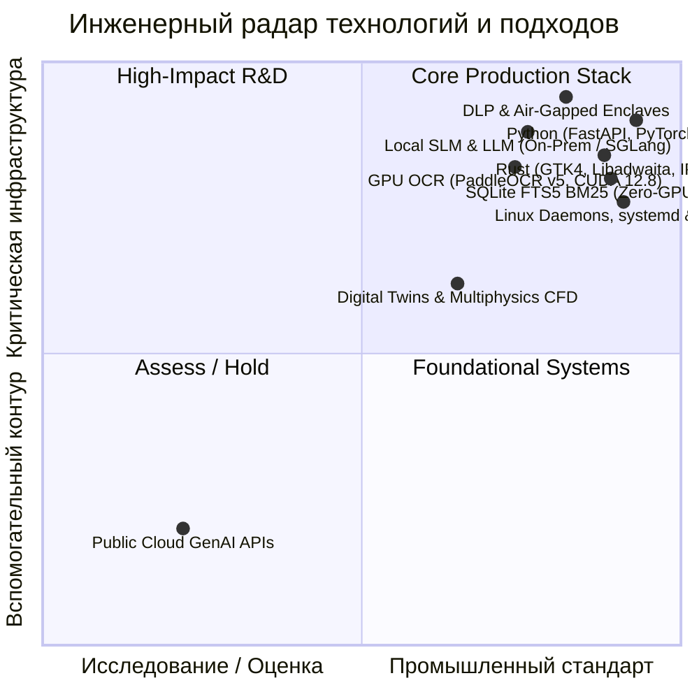

# Павел Наумов

  
  
  
  
  

  

---

## 🧭 Позиционирование и профиль

Инженерный руководитель (VP of Engineering / Head of R&D / Principal Architect) с **17+ годами практики** в разработке наукоемкого ПО, построении критической ИТ-инфраструктуры и внедрении локальных систем искусственного интеллекта на промышленных предприятиях.

Специализируюсь на создании **суверенных On-Premise и Edge AI контуров**, где публичные облачные API неприменимы по соображениям государственной или коммерческой тайны (DLP, Air-Gapped периметры, защита от утечек исходного кода). Проектирую системы с жесткими ограничениями по ресурсам — от гарантированной работы на офисных CPU до распределенного инференса на GPU-кластерах NVIDIA.

---

## 🎯 Инженерный радар технологий (Tech Radar)

Радар отражает баланс между проверенными производственными стандартами и исследованиями с высоким бизнес-эффектом:

---

## 🚀 Избранные публичные разработки (Open R&D)

<table width="100%">
  <tr>
    <td width="33%" valign="top">
      <h3>🦀 <a href="https://github.com/Bezooom/yandex-messenger-native">yandex-messenger-native</a></h3>
      
<b>Стек:</b> <code>Rust</code>, <code>GTK4</code>, <code>Libadwaita</code>, <code>WebKitGTK</code>

      
Нативный десктопный клиент для Яндекс.Мессенджера под Linux в стандартах GNOME HIG.

      <ul>
        <li><b>Footprint:</b> &lt; 45 МБ RAM против ~500 МБ у решений на Electron</li>
        <li><b>Графика:</b> аппаратное ускорение рендеринга и полная поддержка Wayland</li>
      </ul>
    </td>
    <td width="33%" valign="top">
      <h3>🧬 <a href="https://github.com/Bezooom/Evocode">Evocode</a></h3>
      
<b>Стек:</b> <code>VSCodium</code>, <code>Local LLM</code>, <code>DLP Engine</code>

      
Российская privacy-first AI-IDE на базе VSCodium со встроенной DLP-фильтрацией.

      <ul>
        <li><b>Безопасность:</b> автоматический перехват секретов, токенов и PII в коде</li>
        <li><b>Автономия:</b> локальный инференс без передачи данных во внешние облака</li>
      </ul>
    </td>
    <td width="33%" valign="top">
      <h3>🫀 <a href="https://github.com/Bezooom/t1d-simulator">t1d-simulator</a></h3>
      
<b>Стек:</b> <code>Python</code>, <code>CFD / FVM</code>, <code>SciPy</code>

      
Открытый калиброванный цифровой двойник для исследований диабета 1 типа.

      <ul>
        <li><b>Модель:</b> кинетика диффузии кислорода и глюкозы в микрокапсулах</li>
        <li><b>Применение:</b> дизайн трансплантатов островковых клеток поджелудочной</li>
      </ul>
    </td>
  </tr>
</table>

---

## 🔒 Промышленный опыт и закрытые проекты (Enterprise & NDA)

Значительная часть архитектурной практики выполняется в рамках корпоративных соглашений о конфиденциальности:

<b>1. Интеллектуальный классификатор ТН ВЭД ЕАЭС и таможенный терминал</b>

 

* **Задача:** Автоматизация предобработки международных товаросопроводительных документов (инвойсы, упаковочные листы, спецификации), детерминированное присвоение 10-значных кодов ТН ВЭД ЕАЭС и расчет таможенных платежей (пошлины ЕТТ, НДС, сборы по ПП РФ № 342).
* **Архитектура:**
  * Гибридный контур: GPU-ускоренный OCR (`PaddleOCR PP-OCRv5` на CUDA 12.8, **< 9 сек/стр**) с пространственной кластеризацией таблиц (`Spatial Bands`).
  * Детерминированное ядро классификации: редукция 12-значных иностранных GTIP к 6-значным субпозициям, FTS5 BM25 поиск с русской лемматизацией (`< 10 мс`).
  * **Trust Boundary (Граница доверия):** автоматическая блокировка автоприсвоения для оружия (группа 93), взрывчатки (группа 36), товаров двойного назначения (БПЛА, радиация, яды) и партий с пошлиной свыше 100 000 ₽.
  * **Human-in-the-Loop Review Queue:** очередь верификации эксперта с фиксацией нормативных оснований и неизменяемым журналом аудита.
* **Метрики качества:** `Fabrication Rate: 0.0%`, `Risk Recall: 100%`, `Automation Precision: 100%`.

<b>2. Автоматизация КТПП и MES-контуров в машиностроении</b>

 

* **Контур:** Интеграция конструкторско-технологической подготовки производства (КТПП) с системами диспетчеризации цехов (MES) и складским учетом ERP.
* **Решения:** Проектирование нормативно-справочных баз изделий (BOM), построение расцеховки, детерминированные алгоритмы нормирования материалов и трудоемкости, синхронизация справочников в транзакционном режиме.

<b>3. Локальные корпоративные RAG-системы и ассистенты инженеров</b>

 

* **Контур:** Внедрение систем анализа внутренней конструкторской, технологической и нормативной документации (ГОСТ, ТУ, ОСТ).
* **Решения:** Air-gapped инсталляции на базе квантованных открытых моделей, гибридный поиск (BM25 + плотные векторные эмбеддинги), фильтрация галлюцинаций через жесткие цитатные барьеры и синтаксическую верификацию.

---

## 🏛 Инженерные принципы (Operating Philosophy)

1. **Детерминизм превыше генеративного хайпа:** в регулируемых отраслях (таможня, финансы, безопасность, медицина) алгоритм обязан давать проверяемый и юридически воспроизводимый результат. ИИ — это ассистент распознавания и поиска, но финальное решение фиксируется строгими правилами.
2. **Data Sovereignty by Design:** коммерческие документы, конструкторские чертежи и исходный код предприятия никогда не должны покидать внутренний контур сети.
3. **Lean Native Footprint:** отдаю предпочтение легковесному компилируемому коду (Rust, C++, оптимизированные расширения Python) вместо прожорливых браузерных контейнеров.
4. **Архитектура шести месяцев (Six-Month Maintainability):** отказ от избыточных фреймворков и хрупких абстракций в пользу простых, понятных и поддерживаемых решений.

---

## 📬 Контакты и публикации

  
  
  

---

  © Павел Наумов &bull; Системный инжиниринг, автономия и прикладной ИИ без компромиссов в безопасности.

